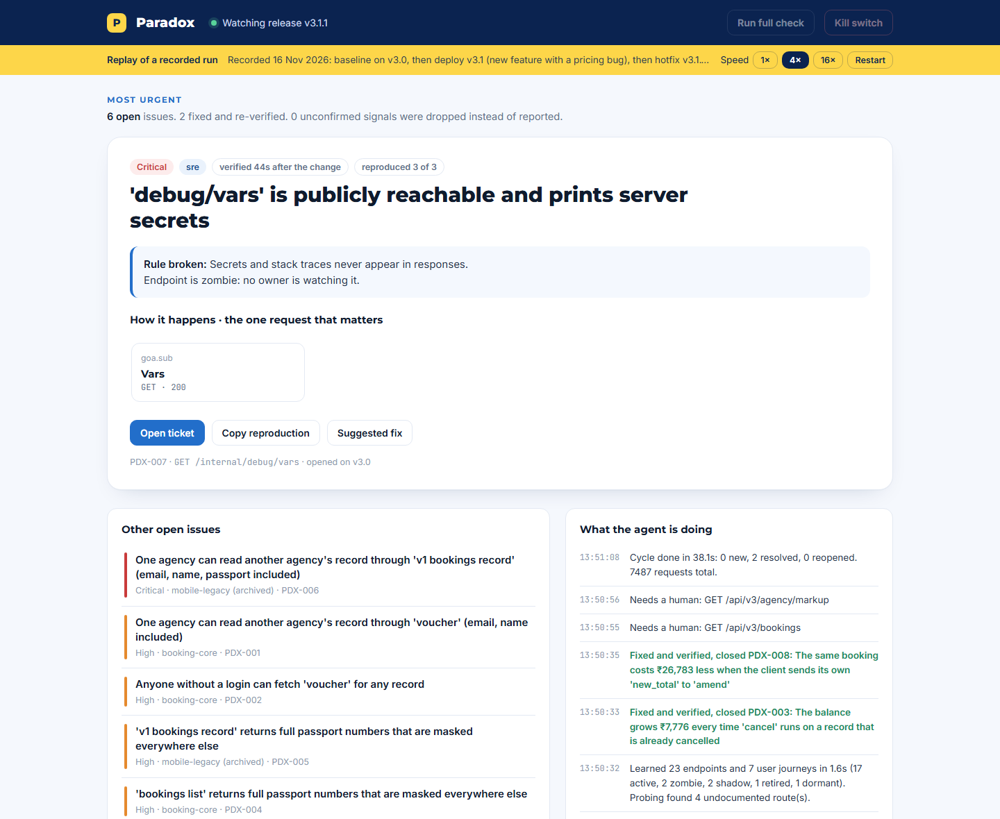

# Paradox

**Agentic real-time DAST for B2B travel platforms. Scanners look for bad inputs; Paradox looks for impossible outcomes.**

VoyageHack 4.0 · Problem statement: *Fraud Prevention & Security: Agentic Real-Time DAST*

**Live replay:** https://harsh07032004.github.io/paradox/ · the control room playing back a real recorded run (baseline on v3.0 → deploy v3.1 ships a pricing bug → hotfix v3.1.1 closes it). Run it live locally with `python run_demo.py`.



The most damaging flaws in a booking platform are business-logic flaws: a refund paid twice, a fare set by the client, one agency reading another's passports. Nothing in the HTTP response looks wrong, so signature scanners miss them. Paradox learns the platform from its own traffic. It then mutates real user journeys and checks **twelve invariants that every correct B2B travel platform must obey**. Wallets are tracked on a shadow ledger, and planted canary data proves leaks. A finding exists only when an invariant breaks. It is reproduced 3/3 from fresh objects, shrunk to a minimal proof, priced in rupees, filed to its owner, and retested on every deploy.

```
deploy ─► learn (bundle + HAR + logs + probing) ─► mutate journeys ─► check invariants on shadow ledger
       ─► reproduce 3/3 ─► delta-debug to minimal proof ─► ₹ severity + owner ticket ─► retest, auto-close
```

## Results (measured, reproducible)

### Mutation benchmark: unseen defects injected at random
`python -m bench.bench --trials 20 --k 5 --seed 31337` · 22 trials (clean, 20 random, all-on) · 19 defect types

| | Recall | Precision | False positives | Defects found |
|---|---|---|---|---|
| **Paradox** | **100%** | **100%** | **0** | **172 / 172** |
| Signature-based baseline (same inputs) | 29.7% | 43.6% | 66 | 51 / 172 |

- Median full cycle **7.3 s**; first verified finding after **1.1 s** (rate cap 400 rps on localhost; 40 rps in the demo).
- The baseline found **0** of the money, isolation, privilege and mass-assignment bugs (M01–M10, M12, M13, amend). Those are exactly the classes the problem statement says scanners miss.
- On the clean build Paradox reports only the two legacy defects that exist in every release (the zombie v1 route and the debug route).

### Holdout: a platform Paradox was not built for
`python -m holdout.run_holdout` · *SkyLane Air B2B* was written after the agent. It uses flights instead of hotels, an `X-Session` header instead of Bearer, a `{login, secret}` login, a `state` lifecycle (ON_HOLD → TICKETED → VOIDED), PNR codes as ids, a credit line instead of a wallet, and a different passport mask.

| Run | Planted bugs found | False positives |
|---|---|---|
| First contact (agent unchanged) | 5 / 7 | 0 |
| After two **generic** fixes (below) | **7 / 7** | **0** (clean build: 0 findings) |

The two misses taught the agent something general, and neither fix mentions the holdout:
1. The credit line moved by *ticket + seat* in one journey. Ledger discovery now accepts a sum of reported amounts.
2. The ticket call accepted the PNR's own `fare` field. Price tampering now also tries the money fields of the object an action operates on.

The main benchmark was re-run after both fixes (the numbers above) and the test suite stays green.

### What Paradox learned about SkyLane on its own
Auth header `X-Session`; login `{login, secret}` → `session`; lifecycle field `state` with ON_HOLD/TICKETED/VOIDED; object type PNR with observer `GET /v2/pnrs/{id}`, settle `ticket`, release `void`; ledger `GET /v2/credit → available` (found by experiment); masked field `passport_no`; single-use value `promo=FIRSTFLY`; `GET /v1/pnrs/{id}` labelled zombie.

## Quick start

Requires Python 3.11+.

```bash
pip install -r requirements.txt
python -m target.traffic          # (re)record HAR + 120 days of gateway logs from a clean sandbox
python -m pytest -q               # 10 tests: safety rules, generality guard, end-to-end, retest
python run_demo.py                # control room on http://127.0.0.1:9000 + scripted release train
```

The demo runs a full baseline cycle on release `v3.0`. It then deploys `v3.1`, whose new *amend booking* feature trusts a client-supplied total; Paradox detects the bundle change and tests the new route first. Finally it deploys the hotfix `v3.1.1`, and the retest closes the fixed tickets on its own.

| Command | What it does |
|---|---|
| `python -m paradox.server` | Agent + dashboard on :9000 against the target in `inputs/scope.json` |
| `python -m bench.bench` | Mutation benchmark vs signature baseline → `bench/results.json` |
| `python -m holdout.run_holdout` | Unchanged agent vs SkyLane holdout → `holdout/results.json` |
| `curl -X POST :8101/deploy -d '{"release":"v3.1"}'` | Simulated CI/CD deploy (control plane, out of agent scope) |
| `python -m scripts.record_replay` | Records a real run of the release train into `site/` (the published replay) |
| `python -m submission.build_deck` | Renders the Round 1 deck (`submission/slides/*.html` → PPTX + PDF), numbers read from the result files |

## Inputs (exactly what the problem statement says teams receive)

| File | Content |
|---|---|
| `inputs/scope.json` | Allowed origins, rate cap, request budget, traffic window |
| `inputs/accounts.json` | Test accounts at two roles across two agencies (tenant, role, privilege; `requires_approval` accounts are never used autonomously) |
| `inputs/har.json` | Recorded normal journeys (proxy HAR) |
| `inputs/access_log.jsonl` | 120 days of gateway access logs |
| `inputs/ownership.json` | Asset ownership (path prefix → team) |

No OpenAPI spec and no source access. Paradox generates `out/openapi.json` as a by-product.

## The invariants

| Class | Invariant | Proof |
|---|---|---|
| Money | A tenant's balance never ends its own sequence richer | Shadow ledger before/after + per-step trace |
| Money | The same final booking never costs less than the untouched journey | Differential run against a control |
| Money | A value the platform rejects on reuse stays rejected | Learned from a rejection in recorded traffic |
| Money | Quantities below one are not priced | Response money ≤ 0 |
| Isolation | Tenant A's canary never reaches tenant B | Canary string in B's response |
| Isolation | Tenant B never changes tenant A's object | A's observer state changed |
| Isolation | Object data never reaches a caller with no session | Canary or object id without a session |
| Authority | An action seen only from a higher role fails for a lower role | State change via the same-route read |
| Authority | Clients cannot set role / tenant / status | Field reflected, or money moved |
| Exposure | A field masked elsewhere is never served in clear | Planted passport in clear |
| Exposure | No secrets or stack traces in responses | Pattern match (error-handler grouped) |
| Exposure | Input cannot change query structure | Boolean TRUE/FALSE result-set differential |

## Safety (20% of the score, enforced in code)

- **Scope allowlist:** any other origin, including the control plane, is refused and logged.
- **Own-object rule:** state-changing calls may only address object ids Paradox created.
- **Rate cap** with token bucket. **Health monitor:** it backs off exponentially on latency spikes or 5xx streaks and halts after sustained strain.
- **Kill switch:** the dashboard button or an `out/KILL` file stops everything before the next request.
- **Audit log:** every request and every refusal is written to `out/audit.jsonl` (passwords redacted, replayable).
- **Cleanup:** objects it opened are released after every experiment, and role or markup changes are restored.
- **Human queue:** policy-dependent observations are never auto-filed.

## Mapping to the judging criteria

| Criterion | Weight | Paradox |
|---|---|---|
| Valid findings and severity | 30% | 100% recall on 172 injected defects; severity from invariant + measured ₹ + PII + reachability + zombie status |
| Precision and noise control | 20% | 0 false positives; 3/3 reproduction; duplicates collapsed by root cause |
| Safety and scope discipline | 20% | See above; covered by tests |
| Speed after change | 10% | Changed routes are tested first; first verified finding about 1 s after the cycle starts |
| Report quality and actionability | 10% | Ticket per finding: invariant, ₹ impact, owner, minimal proof table with ledger trace, curl repro, fix, retest history |
| Discovery and API inventory | 10% | Active / zombie / shadow / retired / new labels with last-seen and a recommendation; generated OpenAPI 3 |

## Repository layout

```
paradox/      the agent: safety, recon, runner, hunt (operators + oracles), triage, engine, server, ui.html
target/       Waypoint B2B sandbox (synthetic), defect catalogue, traffic recorder
holdout/      SkyLane Air B2B holdout target + evaluation
bench/        mutation benchmark + signature baseline
tests/        pytest suite
docs/         ARCHITECTURE.md, DEMO_SCRIPT.md, dashboard screenshot
scripts/      demo (sandbox + agent + scripted deploys), replay recorder
site/         static control room + recorded run, published to GitHub Pages
submission/   Round 1 deck (PPTX, PDF), slide sources, speaker notes, builder
```

## Limitations (stated plainly)

- Paradox needs at least one recorded journey per flow. Endpoints with no traffic are reached by grafting onto recorded journeys and by synthesising steps from the bundle's request shapes, but a flow nobody recorded and no bundle references will get only inventory-level coverage.
- Isolation tests need test accounts in at least two tenants, and privilege tests need two roles in one tenant. The problem statement provides both.
- The money invariants assume test accounts have a readable balance or credit line. Paradox finds it by experiment; if none exists, money invariants are off and the dashboard says so.
- All data is synthetic. Both targets are sandboxes written for evaluation; their defect catalogues are used only by the benchmark, never by the agent (a test fails if any target route, id, status value or defect id appears in the agent's decision code).
