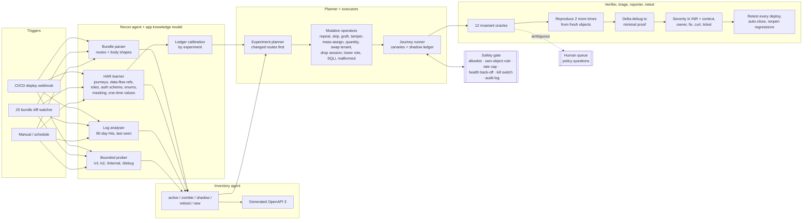

# Paradox architecture

Paradox maps onto the problem statement's reference architecture one-to-one. Its core idea differs from it in one place: findings come from **business invariants checked on a shadow ledger**, not from payload signatures.

## Components

| Reference component (problem statement) | Paradox module | Notes |
|---|---|---|
| Change triggers | `server.py` (`/hooks/deploy`, bundle watcher), `engine.learn()` diff | New or changed route signatures become the focus set; experiments touching them run first. |
| Recon agent + knowledge graph | `recon.py`, `runner.Semantics` | Routes from the bundle; journeys from HAR with **data-flow references** (which response value feeds which later request); object types, observer, settle and release actions; lifecycle enum; masking policy; one-time values; auth scheme. |
| Inventory agent | `recon.probe`, `recon.classify`, `recon.openapi` | Probing is bounded (version neighbours plus ~90 internal/debug paths). "Route exists" is decided by comparing to the fingerprint of a random non-existent route. |
| Attack planner | `hunt.Hunter.plan` | Operators are applied to learned journeys, never sprayed. Deduplicated by (operator, endpoint, field, context). |
| Specialist executors | `hunt.Hunter.execute`, `runner.Runner.run` | One runner, many operators. Every run plants canaries and snapshots wallets. |
| Safety layer | `safety.Gate` | Enforced in code. The own-object rule means state-changing calls may only address object ids Paradox created. |
| Verifier | `hunt.verify`, `hunt.minimise` | 3/3 reproduction from fresh objects, then delta-debugging. |
| Triage + reporter | `triage.py` | Severity from the invariant, measured INR, data class (PII), reachability, and zombie/shadow status. Owner comes from asset-ownership data. |
| Retest | `engine.retest` | Runs every cycle. A proof that no longer reproduces twice closes the ticket. A closed finding that comes back is reopened as a regression. |
| Human reviewer | `hunt._add_review`, dashboard queue | Policy-dependent observations (e.g. a lower role can *read* something) are never auto-filed. Accounts flagged `requires_approval` are never used autonomously. |

## The invariants

| Invariant | How it is measured | Typical bugs it catches |
|---|---|---|
| `money_created` | Wallet after > wallet before, for one agency's own sequence | Double refund, refund of an unpaid hold, refund on pre-discount gross, negative quantity |
| `underpayment` | Same final object state as the untouched journey, but less money moved | Client-set price or fare, status set to confirmed without payment |
| `cross_tenant_read` | Agency A's canary (or object id plus tenant id) appears in agency B's response | IDOR / BOLA on bookings, invoices, legacy routes |
| `cross_tenant_write` | Agency B's action changes agency A's object state or wallet | Cancel or modify another agency's booking |
| `unauthenticated_access` | Canary or object id served with no session | Vouchers, e-tickets |
| `privilege_escalation` | An action seen only from a higher role succeeds from a lower role and changes state | Sub-agent changes markup or limits |
| `mass_assignment` | Client-supplied role / tenant field is reflected | Self-promotion to admin |
| `one_time_reuse` | A value the platform rejected on reuse in recorded traffic is accepted twice | Coupon or promo reuse |
| `invalid_quantity` | Zero or negative quantity accepted and priced at or below zero | Negative rooms or seats |
| `pii_exposure` | A planted passport appears in clear where the platform masks it elsewhere | List endpoints, legacy routes |
| `secret_exposure` | Secret / credential / stack-trace patterns in any response | Debug routes, verbose error handler |
| `sql_injection` | A boolean TRUE condition grows the result set and FALSE shrinks it | Filter concatenation |

## Why there is no LLM in the decision path

The judging rewards precision (20%) and safety (20%). Every Paradox finding is a deterministic, replayable proof, so there is nothing to hallucinate and nothing to tune. An LLM can be added at the edges, for example to label opaque field names or to write narrative ticket text. Those uses are optional plug-ins and never decide whether something is a finding.

## Extending

- **New invariant:** add an oracle in `Hunter._evaluate` and a severity/fix entry in `triage.py`.
- **New operator:** add it in `Hunter.plan`; the runner already supports per-step actor, skip, repeat, field override, query override and raw body.
- **New target:** provide `inputs/` (scope, accounts with tenant/role/privilege, HAR, access logs, ownership). No code changes. The SkyLane holdout proves this.
